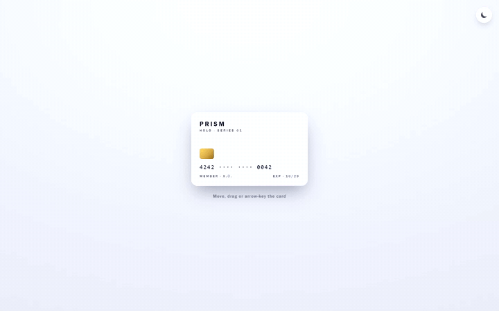
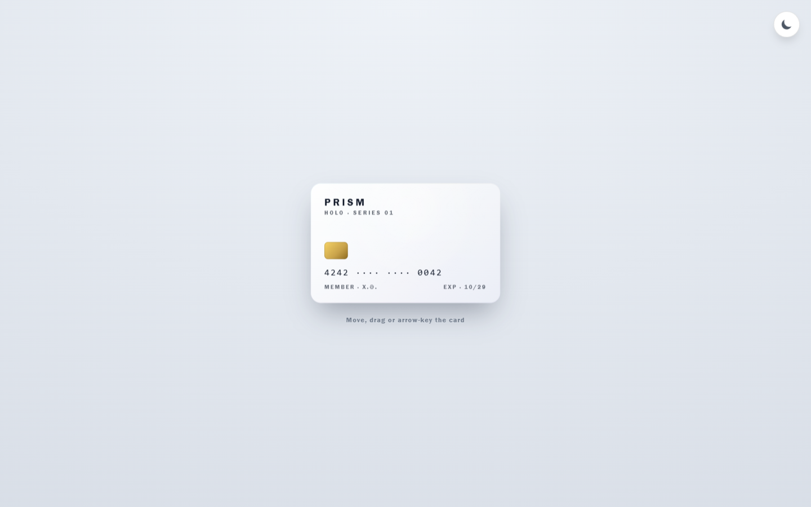
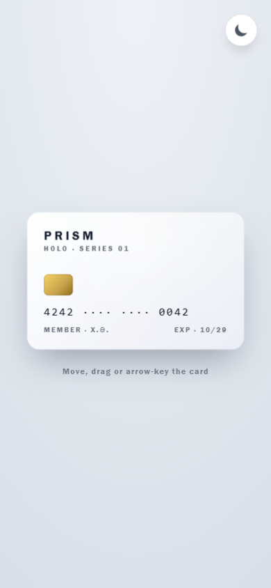

# Interactive-3D-Card

A React card that tilts in 3D and carries a holographic foil layer — pointer, touch drag and keyboard all drive it, and it settles back on a spring.

**Live demo:** <https://3dcard-hover-effect.netlify.app/>

<div align="center">



| Desktop (revamp) | Mobile (revamp) |
|---|---|
|  |  |

</div>

## What it does

The card reads pointer position and maps it to `rotateX`/`rotateY` (±18°), tracked by Motion springs instead of React state — so moving the cursor never re-renders the component, and lifting the cursor lets the card spring back instead of snapping flat. A conic-gradient foil layer shifts hue with the tilt, a radial glare follows the cursor, and the chip, card number and footer lift on their own `translateZ` planes while the card is active.

On touch the same pointer handlers become drag-tilt: press the card, drag, release, and it returns to rest. `deviceorientation` was deliberately skipped — iOS requires a permission prompt for it, and drag feels better anyway.

Everything works without a pointer too. The card is focusable, arrow keys tilt it in 6° steps, Escape (or Enter/Space) resets it. With `prefers-reduced-motion: reduce` the tilt, springs and depth layers switch off entirely and the card stays a static foil piece — same content, same theme toggle.

Theme resolution checks `localStorage` first, falls back to `prefers-color-scheme`, and writes the choice back so it survives reloads.

## Tech stack

React 19 · TypeScript (strict) · Vite 6 · Motion 14 · CSS Modules

## Features

- Spring-based tilt: pointer position → springs for rotation and scale, one mechanism for follow and return
- Touch drag tilt (gyro-free) via unified pointer events, `touch-action: none` scoped to the card
- Holographic foil layer whose hue rotates with tilt + cursor-following glare
- Depth stack: content layers rise on `translateZ` planes while the card is active
- Keyboard equivalent: focus, arrow keys to tilt, Escape/Enter/Space to reset
- Reduced-motion static fallback, verified in the browser
- Dark/light theme with `localStorage` + `prefers-color-scheme`
- Fluid card size (`clamp`) on a credit-card 1.586:1 proportion

## Run locally

```bash
git clone https://github.com/Mister2314/Interactive-3D-Card.git
cd Interactive-3D-Card
npm install
npm run dev
```

`npm run typecheck` runs `tsc --noEmit`; `npm run build` runs it before the Vite build.

## Accessibility notes

The card exposes `role="group"` with an `aria-label` describing the keyboard controls, a visible focus ring, and a hint line that tells users which input mode is live. The tilt is capped at ±18° so the card stays readable at its extremes.
