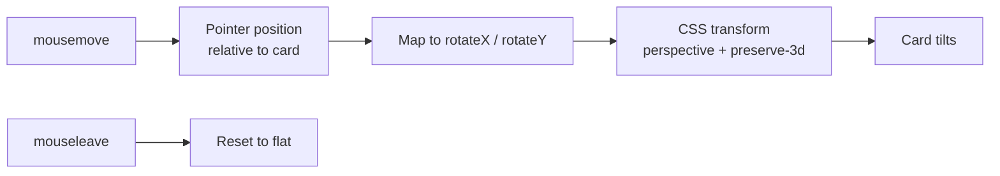
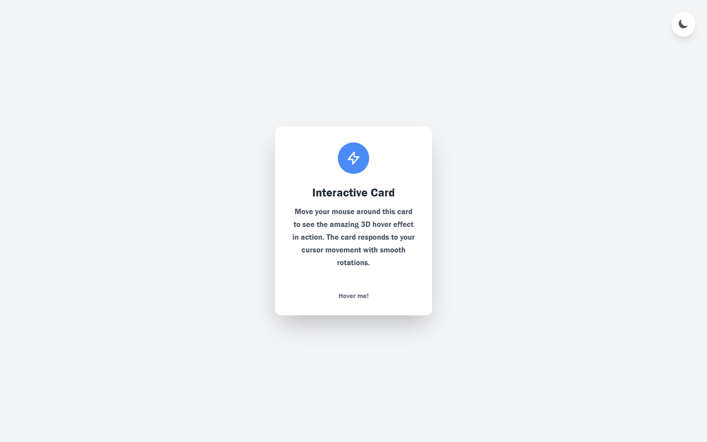
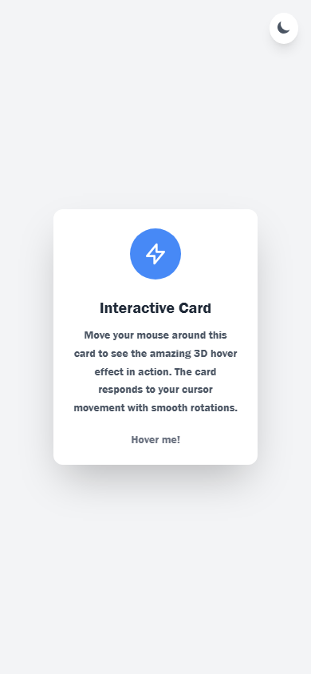

<h1 align="center">Interactive 3D Card</h1>

<p align="center"><b>A pointer-tracked card that tilts in real 3D space and lights up as you move across it, with automatic dark mode.</b></p>

<p align="center">
<a href="https://3dcard-hover-effect.netlify.app/"></a>


</p>

<p align="center"><a href="https://3dcard-hover-effect.netlify.app/"><b>Live demo</b></a> &nbsp;·&nbsp; <a href="#quick-start">Quick start</a> &nbsp;·&nbsp; <a href="#features">Features</a> &nbsp;·&nbsp; <a href="#architecture">Architecture</a> &nbsp;·&nbsp; <a href="#faq">FAQ</a></p>

<p align="center">
  <a href="https://3dcard-hover-effect.netlify.app/">
    
  </a>
</p>

<p align="center"><sub>Live capture of the real build — 840 KB, loops forever.</sub></p>

## Overview

A single card that reads the pointer position over it, converts that position into `rotateX` / `rotateY` angles and applies them as a CSS 3D transform — so the card appears to lean towards the cursor. Move away and it springs back to flat.

There is no animation library here on purpose. The transform is written straight to React state and handed to CSS, which keeps the effect easy to follow and trivial to tune.

The card also carries its own theme: it reads `localStorage` first and falls back to the `prefers-color-scheme` media query, then re-renders in the matching palette.

## At a glance

| Field | Detail |
| --- | --- |
| **Type** | Web application — Vite build |
| **Primary language** | JavaScript |
| **Live demo** | [3dcard-hover-effect.netlify.app](https://3dcard-hover-effect.netlify.app/) |
| **Repository** | [Mister2314/Interactive-3D-Card](https://github.com/Mister2314/Interactive-3D-Card) |

## Features

- Pointer-position → `rotateX` / `rotateY` transform, updated live on `mousemove`
- Card returns to its resting position on `mouseleave`
- Gloss / highlight layer that follows the cursor
- Dark mode resolved from `localStorage`, falling back to `prefers-color-scheme`
- Theme changes are written back to `localStorage`
- Component-scoped styling with CSS Modules

## Tech Stack

| Layer | Technology |
| --- | --- |
| UI | React 19 |
| Effect | CSS 3D transforms driven by React state |
| Styling | CSS Modules |
| Build | Vite, ESLint |

## Architecture



## Screenshots

| Desktop | Mobile |
| :---: | :---: |
|  |  |

## Quick Start

```bash
git clone https://github.com/Mister2314/Interactive-3D-Card.git
cd Interactive-3D-Card
npm install
npm run dev
```

## Project Structure

```
src/components/InteractiveCard.jsx — pointer tracking, transform maths, theme resolution
src/components/InteractiveCard.module.css — 3D perspective, gloss layer and both palettes
src/App.jsx — mounts the card
```

## FAQ

<details>
<summary><b>Why no animation library?</b></summary>

The whole effect is one transform value driven by pointer position. Adding a library would have hidden exactly the part worth understanding.

</details>

<details>
<summary><b>Does the tilt work on touch devices?</b></summary>

Not currently — `mousemove` does not fire on touch. Touch support would need `touchmove` plus a fallback that keeps the card flat.

</details>

<details>
<summary><b>How is dark mode chosen?</b></summary>

`localStorage` first, then the `prefers-color-scheme` media query, and any change is written back to `localStorage`.

</details>

## Roadmap

- [ ] Add touch / pointer-events support
- [ ] Expose the tilt intensity as a prop
- [ ] Add a reduced-motion path that disables the effect

## Notes

Doing this without a library was the whole exercise: it forced me to understand what `perspective` and `transform-style: preserve-3d` actually do before reaching for a package that hides them.

## Author

**Xəyal Hüseynli** — Junior Front-End Developer

[Portfolio](https://hypnosdev.vercel.app) · [GitHub](https://github.com/Mister2314) · [LinkedIn](https://www.linkedin.com/in/x%C9%99yal-h%C3%BCseynli-3487b91ba/) · [xeyalhuseynli06@gmail.com](mailto:xeyalhuseynli06@gmail.com)
