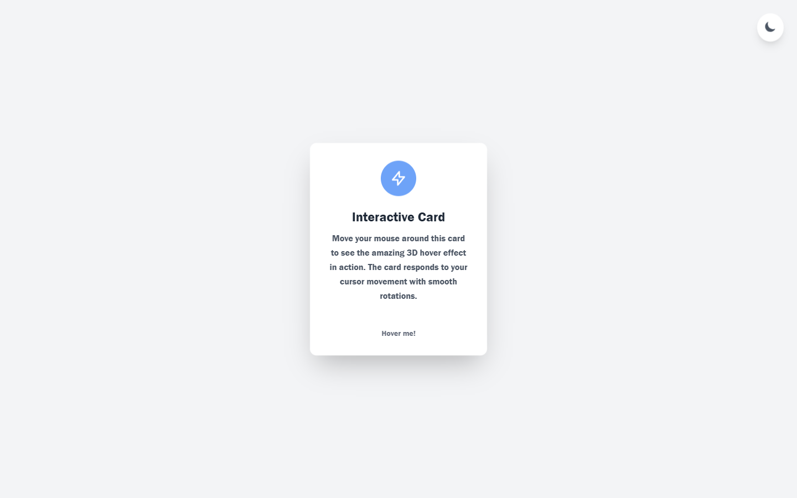
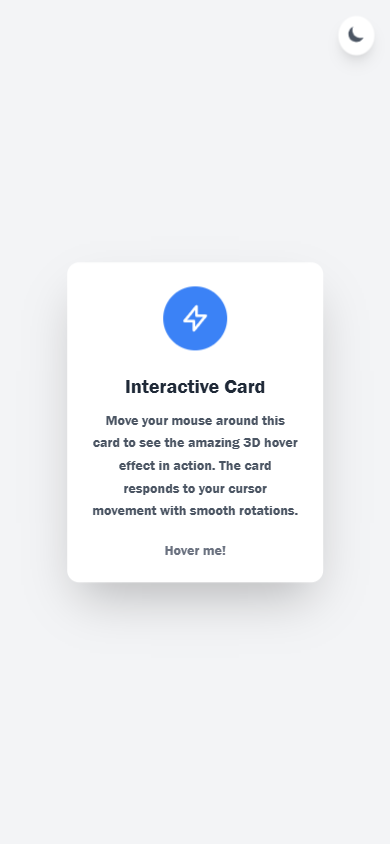

# Interactive-3D-Card

A React card that tilts in 3D following the pointer and switches between dark and light themes.

**Live demo:** <https://3dcard-hover-effect.netlify.app/>

<p align="center">
<div align="center">

| Desktop | Mobile |
|---|---|
|  |  |

</div>
</p>

## What it does

The card reads pointer position on `mousemove`, maps it to `rotateX`/`rotateY` values (±30°, scaled by distance from center), and writes the transform straight into React state — no animation library. Moving off the card resets it to flat. A gloss layer follows the cursor while hovering.

Theme resolution checks `localStorage` first, falls back to `prefers-color-scheme`, and writes the choice back so it survives reloads.

## Tech stack

React 19 · Vite 6 · CSS Modules

## Features

- Pointer-to-transform math: position → `rotateX`/`rotateY`, applied live on `mousemove`
- Flat reset on `mouseleave`, scaled up 1.05× while hovered
- Cursor-following gloss/highlight layer
- Dark mode from `localStorage` with `prefers-color-scheme` fallback
- Scoped styling with CSS Modules

## Run locally

```bash
git clone https://github.com/Mister2314/Interactive-3D-Card.git
cd Interactive-3D-Card
npm install
npm run dev
```

## What I learned

`perspective(1000px)` and `transform-style: preserve-3d` had to be understood by hand — the tilt is one transform string, so there is no package to hide the math behind.

Limitation: the tilt only responds to `mousemove`, so it does not react on touch devices.
